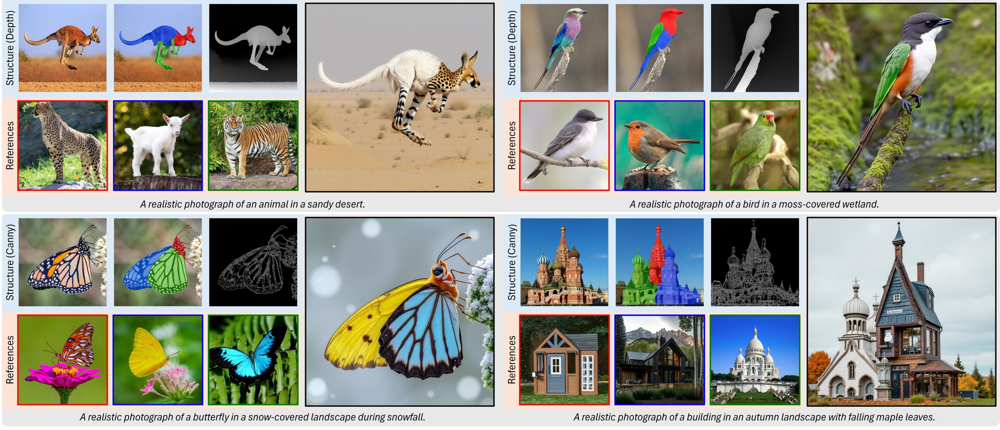
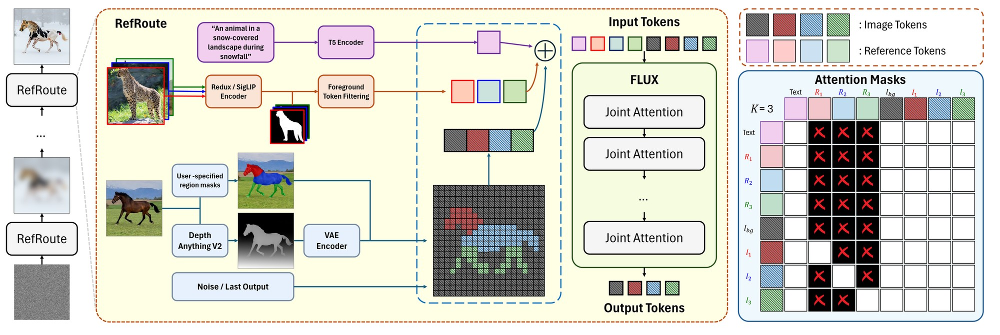

# RefRoute (WACV 2027)

> **RefRoute: Connectivity-Preserving Routing for Part-Level Multi-Reference Composition**
> <br>
> Jeongseon Cho, Youngjae Kim, and Jihoon Yang
> <br>
> Sogang University
> <br>



RefRoute transfers a different reference image onto each part of a single
object, for example a cheetah's head, a goat's torso, and a tiger's legs on one
kangaroo. It works on FLUX without training: each part reads only its own
reference, while the image tokens of all parts can still attend to each other,
so the parts stay one connected object.

## Getting Started

### 1. Environment setup

```bash
git clone https://github.com/IMJeongseon/RefRoute.git
cd RefRoute

conda create -n refroute python=3.12
conda activate refroute
pip install -r requirements.txt --extra-index-url https://download.pytorch.org/whl/cu128
```

Accept the licenses of
[FLUX.1-dev](https://huggingface.co/black-forest-labs/FLUX.1-dev),
[FLUX.1-Depth-dev](https://huggingface.co/black-forest-labs/FLUX.1-Depth-dev),
[FLUX.1-Canny-dev](https://huggingface.co/black-forest-labs/FLUX.1-Canny-dev), and
[FLUX.1-Redux-dev](https://huggingface.co/black-forest-labs/FLUX.1-Redux-dev)
on Hugging Face, then run `huggingface-cli login`. The weights download on first
use. The paper's runs used one RTX PRO 6000 Blackwell with CUDA 12.8.

### 2. Input preparation

You need a structure image, three reference images, and an overlay: a copy of
the structure image with each target part painted red, blue, or green. Edit the
paths in `code/configs/preparation_example.yaml`, then run:

```bash
cd code
python src/prepare.py --config configs/preparation_example.yaml
```

This writes the target-part masks, the depth map, the reference foreground
masks (BiRefNet), and `data/prepared/<structure>_v6/config.yaml`. Both scripts
run from `code/`, and every path in a config is relative to it.

### 3. Inference

```bash
python src/run.py --config data/prepared/<structure>_v6/config.yaml
python src/run.py --config data/prepared/<structure>_v6/config.yaml --control-type canny
```

The output is written to `outputs/<structure>.png`. The defaults are the
paper's settings: 1024x1024, 20 steps, seed 0, lambda 3, tau 0.3, guidance 10
for depth and 30 for Canny. For a number of parts other than three, write the
config directly with your own masks, following
`code/configs/generation_example.yaml`.

### 4. Reproducing the paper's numbers

The per-configuration metrics, anonymized human ratings, and runtime
measurements are in `results/`. These commands recompute the reported numbers
from them, with only Python and NumPy:

```bash
python results/analyze_metrics.py --all-runs --check
python results/verify_human_eval.py --check
python results/verify_runtime.py --check
```

The benchmark images are not redistributed. `benchmark/` holds the metadata of
the 60 configurations, and [docs/RELEASE.md](docs/RELEASE.md) describes what is
and is not released. [code/CODE_MAP.md](code/CODE_MAP.md) explains each source
file.

## Method



Foreground-selected Redux tokens from each reference are appended after the
text tokens. The attention mask routes each target part to its own reference
and leaves image-to-image attention open across parts. The same mask is used in
every block and at every denoising step.

## Citation

```bibtex
@inproceedings{refroute2027,
  title={RefRoute: Connectivity-Preserving Routing for Part-Level Multi-Reference Composition},
  author={Cho, Jeongseon and Kim, Youngjae and Yang, Jihoon},
  booktitle={Proceedings of the IEEE/CVF Winter Conference on Applications of Computer Vision (WACV)},
  year={2027}
}
```
